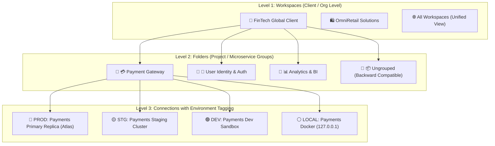

# Mongo Studio: Workspace & Environment Left Panel Design

> **สถานะ:** เสนอการออกแบบ (Proposed Design & HTML Mockup)  
> **ไฟล์ HTML ตัวอย่างต้นแบบ:** [design/workspace_left_panel.html](file:///Users/worldinfinity/Desktop/claude/mongodb-admin-tools/design/workspace_left_panel.html)  
> **วันที่:** 13 พฤศจิกายน 2026

---

## 1. ปัญหาและ Pain Points ของ Connection Explorer ปัจจุบัน

ในเวอร์ชันปัจจุบัน เมนู Connection ที่ Left Panel แสดงผลเป็น **Flat List แบบชั้นเดียว** (`Vec<ConnectionConfig>`):
1. **เมื่อมี Connection จำนวนมาก (20 - 50+ clusters):** ผู้ใช้ที่ต้องดูแลหลายลูกค้า (Clients), หลายโครงการ (Microservices/Projects) และหลายสภาพแวดล้อม (Environments) ต้องเลื่อน scroll ยาวมาก หา database ได้ยาก
2. **ความเสี่ยงร้ายแรงในการทำงานผิด Environment:** `Production`, `Staging`, `Development`, และ `Local` มีรูปลักษณ์ภายนอกเหมือนกันแทบทั้งหมด ไม่มี visual hazard warning ทำให้มีความเสี่ยงสูงที่จะเผลอรันคำสั่งลบ (`drop()`, `deleteMany()`) หรือ update บนฐานข้อมูล Production จริง
3. **ขาดการจัดระเบียบตาม Context:** ไม่สามารถแยก Connections ของแต่ละลูกค้าหรือแต่ละทีมออกจากกันได้
4. **การค้นหาจำกัด:** ค้นหาได้เฉพาะ string match ชื่อ connection หรือ database แต่กรองตาม Environment หรือ Project ไม่ได้

---

## 2. โครงสร้างสถาปัตยกรรมใหม่ (Hierarchical Architecture)

เราออกแบบให้แบ่งออกเป็น **3 ระดับชั้น (Levels)** ที่มีความยืดหยุ่นสูง:



---

## 3. องค์ประกอบสำคัญของ UI ด้านซ้าย (Left Panel Components)

### 3.1. Workspace Switcher & Creator (ส่วนบนสุด)
* **Custom Dropdown Selector:** แสดงชื่อและไอคอนของ Workspace ปัจจุบัน (เช่น `🏢 FinTech Global Client (11 connections • 4 projects)`)
* **Unified Mode ("🌐 All Workspaces"):** สำหรับผู้ใช้ที่ต้องการเห็นทุก connection พร้อมกันเหมือนเดิม
* **ปุ่มลัด:**
  * `+ Connection` (สร้าง connection ใหม่โดยผูกเข้ากับ Workspace/Folder ที่เลือกอยู่ทันที)
  * `+ Folder` (สร้างโฟลเดอร์สำหรับจัดกลุ่มโปรเจกต์ใหม่)

### 3.2. Quick Environment Filter Chips (ชิปตัวกรองสภาพแวดล้อม)
* แสดงชิปพร้อมจำนวนนับแบบ Dynamic:
  * `[All (11)]`
  * `[🔴 Prod (3)]`
  * `[🟡 Staging (3)]`
  * `[🟢 Dev (3)]`
  * `[⚪ Local (2)]`
* เมื่อคลิก จะกรอง connection ใน tree ทันที และซ่อนโฟลเดอร์ที่ไม่มี connection ตรงตามเงื่อนไข

### 3.3. Live Search & Highlight
* ช่องค้นหาที่รองรับการพิมพ์ชื่อ connection, hostname, database หรือ tags (เช่น `shard-0`, `auth`, `replica`, `docker`)
* ขยาย (Auto-expand) โฟลเดอร์ที่มีผลการค้นหาตรงกันโดยอัตโนมัติ

### 3.4. Tree Hierarchy & Folder Management
* **Collapsible Folders:** พับ/กางโฟลเดอร์ได้อิสระ บันทึกสถานะ `expanded` ไว้ใน config
* **Folder Actions (`...` context menu):**
  * *Add Connection Inside*
  * *Rename Folder*
  * *Disconnect All in Folder*
  * *Delete Folder* (connection ข้างในจะไม่ถูกลบ แต่จะถูกย้ายไปที่ `Ungrouped`)
* **Ungrouped Section:** รองรับ connection ที่ยังไม่ได้จัดเข้าโฟลเดอร์ เพื่อให้ระบบเดิมเข้ากันได้ 100%

### 3.5. Environment Safeguards & Production Protection (ระบบความปลอดภัยระดับสูง)
* **🔴 PROD Safeguards:**
  * มีขอบซ้ายสีแดงชัดเจน (`border-left: 3px solid #ef4444`)
  * มี Badge `🔒 PROD` สีแดงเข้ม ตัวหนังสือคมชัด
  * มี indicator แสดงการต่อผ่าน SSH Bastion
  * **Destructive Confirmation Guardrail:** เมื่อกด Drop Database, Drop Collection, หรือ Delete เอกสารใน Production จะต้องพิมพ์ชื่อ connection หรือมี dialogue แจ้งเตือนสีแดงเสมอ
* **🟡 STAGING:** Badge สีเหลืองทอง / Amber สำหรับ cluster ทดสอบก่อน deploy
* **🟢 DEV:** Badge สีเขียวมรกต สำหรับ dev sandbox
* **⚪ LOCAL:** Badge สีเทากลาง สำหรับ localhost / docker containers

---

## 4. ข้อเสนอโครงสร้างข้อมูล Rust (Rust Data Models)

### 4.1. การขยายโมเดล `EnvironmentType`
```rust
#[derive(Debug, Clone, Copy, PartialEq, Eq, Serialize, Deserialize, Default)]
pub enum EnvironmentType {
    Production,
    Staging,
    Development,
    #[default]
    Local,
}

impl EnvironmentType {
    pub const fn label(&self) -> &'static str {
        match self {
            Self::Production => "PROD",
            Self::Staging => "STG",
            Self::Development => "DEV",
            Self::Local => "LOCAL",
        }
    }

    pub const fn is_production(&self) -> bool {
        matches!(self, Self::Production)
    }
}
```

### 4.2. โมเดล `FolderGroup` และ `WorkspaceConfig`
```rust
#[derive(Debug, Clone, Serialize, Deserialize)]
pub struct FolderGroup {
    pub id: Uuid,
    pub name: String,
    pub icon: Option<String>,
    pub expanded: bool,
    pub connection_ids: Vec<Uuid>,
}

#[derive(Debug, Clone, Serialize, Deserialize)]
pub struct WorkspaceConfig {
    pub id: Uuid,
    pub name: String,
    pub icon: String,
    pub folders: Vec<FolderGroup>,
    pub ungrouped_ids: Vec<Uuid>,
}
```

### 4.3. การอัปเดต `ConnectionConfig` (Non-breaking Backward Compatibility)
```rust
pub struct ConnectionConfig {
    // ฟิลด์เดิมทั้งหมดคงไว้เหมือนเดิม 100%
    pub id: Uuid,
    pub name: String,
    pub uri: String,
    pub host: String,
    pub status: ConnectionStatus,
    pub expanded: bool,
    pub databases: Vec<DatabaseInfo>,
    // ...
    // ฟิลด์ใหม่พร้อม #[serde(default)]:
    #[serde(default)]
    pub environment: EnvironmentType,
    #[serde(default)]
    pub safe_mode: bool,          // เปิดใช้งานระบบยืนยันความปลอดภัยสำหรับงานเขียน/ลบ
    #[serde(default)]
    pub workspace_id: Option<Uuid>,
    #[serde(default)]
    pub folder_id: Option<Uuid>,
    #[serde(default)]
    pub tags: Vec<String>,
}
```

---

## 5. การรองรับข้อมูลเดิม (Migration & Backward Compatibility)

1. **เมื่อเปิดแอปพลิเคชันครั้งแรกหลังจากอัปเดต:**
   * หากยังไม่มีไฟล์ `workspaces.json` ระบบจะสร้าง **"Default Workspace"** ขึ้นมาให้อัตโนมัติ
   * นำ connection เดิมทั้งหมดใน `connections.json` มาใส่ไว้ใน `ungrouped_ids`
   * กำหนด environment ของ connection เดิมตามชื่อ/host โดยอัตโนมัติแบบ heuristic (เช่น ถ้า host มีคำว่า `prod` หรือ `atlas` แนะนำเป็น `Production`, ถ้ามีคำว่า `localhost` หรือ `127.0.0.1` กำหนดเป็น `Local`)
2. **ไม่สูญหายของการตั้งค่าเดิม:**
   * Connection ID, SSH credentials, และ Saved Passwords ใน Keychain ยังคงเชื่อมโยงด้วย `Uuid` เดิมทุกประการ

---

## 6. ลิงก์ไฟล์สำหรับเปิดดูและทดสอบ

1. **HTML Interactive Mockup:**  
   [design/workspace_left_panel.html](file:///Users/worldinfinity/Desktop/claude/mongodb-admin-tools/design/workspace_left_panel.html)  
   *(สามารถเปิดผ่านเบราว์เซอร์เพื่อลองคลิก สลับ Dark/Light mode, ทดสอบฟิลเตอร์ Prod/Stg/Dev, และลองค้นหาได้เสมือนใช้งานจริง)*

2. **เอกสารการออกแบบฉบับนี้:**  
   [design/WORKSPACE_DESIGN.md](file:///Users/worldinfinity/Desktop/claude/mongodb-admin-tools/design/WORKSPACE_DESIGN.md)
